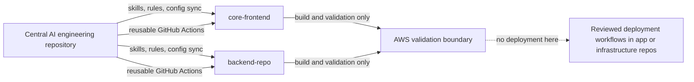

# OneStage AI Engineering Governance

`onestage-ai-engineering` is the canonical engineering-policy repository for the NUS OneStage ticketing platform. It supplies AI-agent skills, enforceable rules, reusable validation workflows, and integration artifacts for `core-frontend` and `backend-repo`. It contains no application source, live Terraform environment, Terraform state, credentials, or deployment workflow.

Rules guide humans and agents but cannot prove compliance. Required CI checks, branch protection, reviews, protected environments, and runtime controls enforce the important boundaries; prose alone is not a security control.

## Structure

| Path | Purpose |
|---|---|
| `skills.d/` | Canonical cross-compatible `SKILL.md` packages. |
| `.agents/skills/`, `.claude/skills/` | Deterministically generated Codex and Claude copies; never edit directly. |
| `rules/`, `configs/` | Focused requirements and shared policy configuration. |
| `integrations/` | Non-installed frontend/backend proposals, caller examples, manifests, and instructions. |
| `.github/workflows/`, `workflows/` | Reusable validation workflows and usage notes; deployment is out of scope. |
| `scripts/`, `tests/`, `evals/` | Synchronization, structural validation, fixture tests, and trigger cases. |
| `docs/` | ADR template and proposed architecture decisions. |
| `AGENTS.md`, `CLAUDE.md` | Concise always-on safety rules and routing. |
| `VERSION`, `CHANGELOG.md` | Policy release identity and history. |



## Canonical source and synchronization

Codex reads `.agents/skills/`; Claude Code reads `.claude/skills/`. Both are byte-for-byte copies of `skills.d/`, including optional skill metadata, so behavior does not fork. Symlinks are deliberately avoided for cross-platform and cloud-agent portability.

The zero-dependency Node.js synchronizer defaults to dry run:

```sh
node scripts/sync-skills.mjs
node scripts/sync-skills.mjs --check
node scripts/sync-skills.mjs --apply
```

`--check` exits non-zero on drift and `--apply` rewrites only changed generated trees. External integration preview and apply are explicit:

```sh
node scripts/sync-skills.mjs --integration=core-frontend=/absolute/path
node scripts/sync-skills.mjs --apply --integration=core-frontend=/absolute/path
```

The target must be a clean Git repository. `--allow-dirty` is a reviewed escape hatch; it does not overwrite text outside marked managed sections. The tool never commits, pushes, deploys, or opens a pull request. Review the diff-oriented dry-run output, apply, then inspect `git diff` in the target. Copy and merge the proposed `.gitignore` additions manually. Caller examples remain `.example` files until exact repository commands and a full central commit SHA replace every unresolved placeholder.

## CI and policy lifecycle

Reusable workflows use `workflow_call`, read-only permissions, timeouts, and no `pull_request_target`. Validation is separate from deployment, and no AWS secrets are accepted. Callers must pin the central workflow reference to a reviewed full commit SHA. The checkout and Node setup action SHAs are annotated with their release versions; updates require independent verification.

Application commands are inputs because the application repositories were unavailable during initial generation. This intentionally makes unresolved configuration visible rather than guessing. Gitleaks, Trivy, Terraform, TFLint, k6, and promtool workflows expect those CLIs on the selected runner; the team must select a pinned installation mechanism or governed runner image before enabling callers. Dependency vulnerability and lockfile checks are supplied through the exact caller audit and frozen-install commands.

Policy versions follow semantic versioning: patch for clarification without changed obligation, minor for backward-compatible new controls/skills, and major for breaking integration or approval changes. Update `VERSION`, `CHANGELOG.md`, affected evals/tests, generated trees, and integration manifests in one reviewed change.

To add a skill, create a concise `skills.d/<name>/SKILL.md` with only `name` and trigger-precise `description` frontmatter, add positive/negative `evals/<name>.json`, validate, synchronize, and review triggering plus operational boundaries. To change a skill, update only the canonical copy and evals. To retire one, deprecate it for a policy release, remove routing references, then remove the canonical package and generated copies in the next compatible release.

CI detects drift with `node scripts/sync-skills.mjs --check`. Roll back policy by reverting the reviewed central policy change, publishing a new version, regenerating integration artifacts, pinning consumers to the reviewed rollback commit, and validating each target diff. Never mutate published history or restore generated folders by hand.

## Security model

Agents receive least authority and inspect before editing. Suspected secrets stop work and are reported without disclosure. Generated output is untrusted until human review. CI cannot deploy and receives no AWS secrets; later AWS workflows should use GitHub OIDC, explicit protected environments/accounts, least-privilege roles, and human approval. Database migrations, IAM, networking, deployments, and destructive operations always require explicit human approval. Secret scanning complements—not replaces—review and secret-store controls.

## ECS on EC2 scaling model

The proposed target keeps the Angular SPA on S3/CloudFront unless documented SSR requires ECS. Node.js services run on ECS EC2. ECS Service Auto Scaling changes task count; the ASG capacity provider's managed scaling changes EC2 count. HTTP services should primarily evaluate ALB requests per target; workers use backlog per task; CPU and memory are guardrails. Managed termination protection/draining, cooldowns, warm capacity, scheduled pre-scaling, waiting-room admission control, rate limiting, and queueing address flash crowds that reactive scaling alone cannot handle. Critical demonstrations use On-Demand capacity. k6 evidence must justify bounds and AWS Budgets must enforce cost ceilings. See `docs/adr/0001-ecs-ec2-platform.md`, which remains proposed.

## Known limitations and unresolved decisions

- `core-frontend` and `backend-repo` were not present, so their package managers, versions, scripts, lockfile behavior, and existing agent/CI configuration are unresolved.
- The GitHub organization repository does not yet exist; no repository, commit, branch, tag, push, or PR was created.
- A pinned, maintained runner/tool installation strategy is needed for Gitleaks, Trivy, Terraform, TFLint, k6, promtool, and Markdown/YAML/shell/Actions validation. Conventional PR-title validation is implemented when the caller supplies the title.
- GitHub environment/account/region details, OIDC roles, budgets, deployment topology, RDS parameters, DNS/TLS, SLOs, capacity limits, and rollback owners remain team decisions. Production deployment stays intentionally absent.
- Managed-section merging is text based. Rename or malformed marker conflicts require manual resolution; `--check` reports drift but does not reconcile user content.

## Local validation

Use Node.js 20 or later:

```sh
node scripts/validate.mjs
node scripts/sync-skills.mjs --check
node --test tests/*.test.mjs
```

Run external linters/scanners only when installed from a trusted pinned source. Never report a check as passed unless its command completed successfully.
